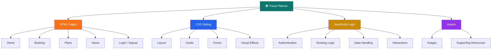
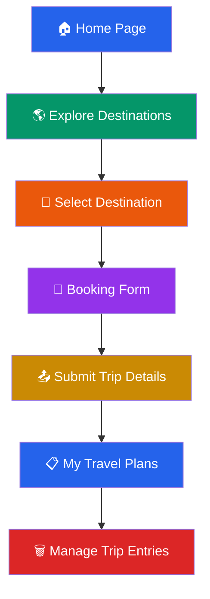
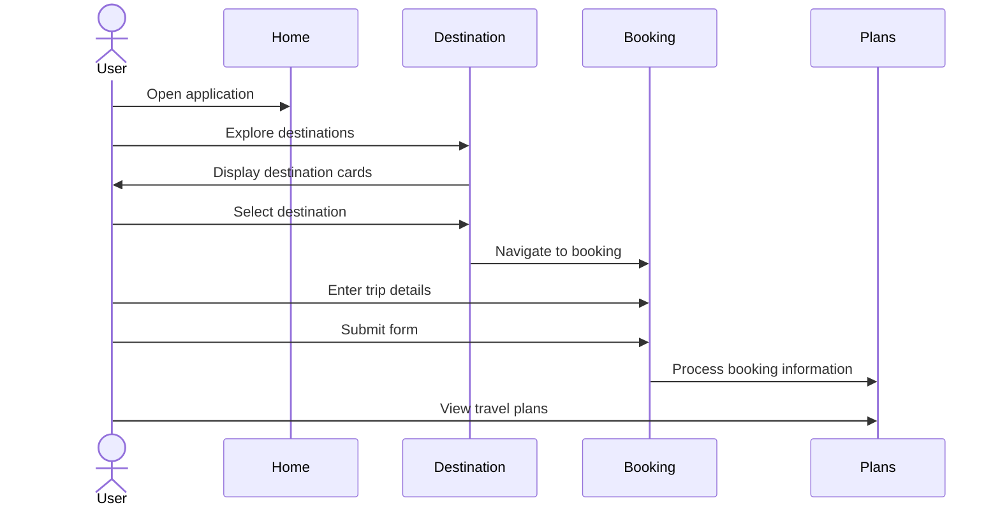
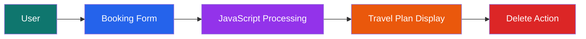
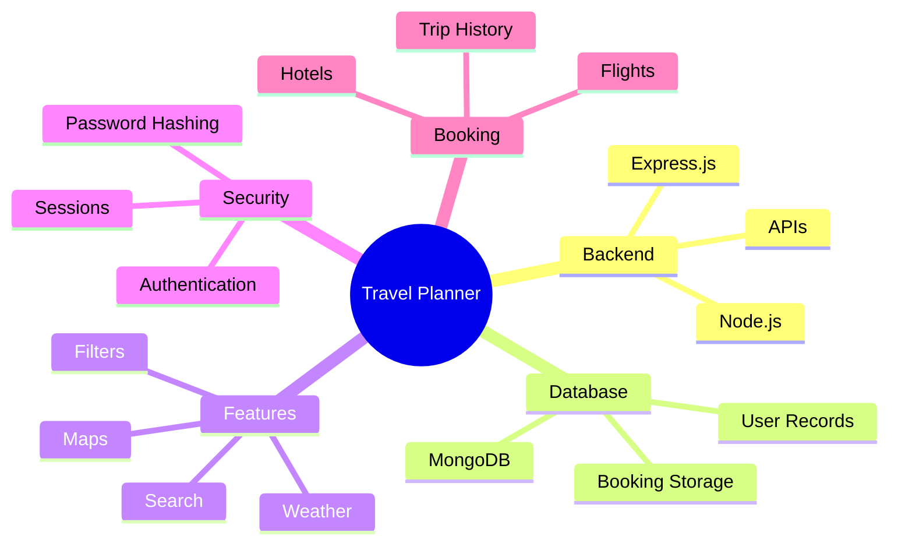

# <div align="center">🌍 TRAVEL PLANNER</div>

<div align="center">

### ✈️ Explore Destinations • Plan Your Journey • Travel Your Way


</div>

---

<div align="center">

**Travel Planner** is a web-based application designed to help users explore destinations, organize travel details, and manage planned journeys through a simple, interactive, and visually appealing interface.

</div>

---

## 📌 Project Overview

Travel Planner is a web-based travel planning application developed using HTML, CSS, and JavaScript. The application provides an organized interface for exploring popular tourist destinations, entering travel booking information, and viewing planned trips.

The website includes a homepage, destination cards, booking form, travel plans management page, login page, signup page, password-reset page, and About page.

The project focuses on providing an engaging user experience through destination images, structured navigation, interactive forms, and a visually appealing layout.

---

## 🎯 Project Objectives

- Develop an interactive travel planning website.
- Create an attractive and user-friendly interface.
- Display popular tourist destinations.
- Provide a booking form for entering travel details.
- Organize travel records through a travel plans page.
- Implement user registration and login interfaces.
- Provide a password-reset interface.
- Develop a multi-page website using HTML, CSS, and JavaScript.
- Improve usability through visual design and navigation.
- Build a foundation for future full-stack travel application development.

---

## 🚀 Features

| Feature | Description |
|---|---|
| 🌎 Destination Exploration | Explore destinations through image-based cards |
| 🧳 Trip Booking | Enter destination, traveler details and travel schedule |
| 📋 Travel Plans | View planned trips in an organized table |
| 🗑️ Trip Management | Manage displayed travel entries |
| 🔐 Sign Up | Registration interface |
| 🔑 Login | Login interface |
| 🔄 Password Reset | Password-reset interface |
| ℹ️ About Page | Information about the application |
| 🎨 Visual Design | Travel imagery, navigation and styled interface |

---

## 🛠️ Technologies Used

| Technology | Purpose |
|---|---|
| HTML5 | Webpage structure |
| CSS3 | Styling, layouts and visual effects |
| JavaScript | Interactive functionality |
| Visual Studio Code | Development environment |
| Web Browser | Application execution |

---

## 🏗️ System Architecture

The Travel Planner application is organized into separate frontend components. HTML provides the page structure, CSS manages the visual presentation, and JavaScript manages the interactions and application behavior.



---

## 📂 Project Structure

```text
Travel-Planner/
│
├── assets/
│   └── Images and resources
│
├── about.html
├── auth.js
├── booking.html
├── data.js
├── forgot.html
├── forgot.js
├── index.html
├── login.html
├── login.js
├── plans.html
├── script.js
├── signup.html
├── style1.css
│
└── README.md
```

---

## 📄 Application Modules

### 🏠 Home Page

The homepage acts as the primary entry point to the application. It introduces the Travel Planner and provides access to destination exploration and other website sections.

### 🌎 Destination Exploration

The destination section presents popular tourist locations using image-based cards.

Destinations represented include:

- Bali, Indonesia
- New York, USA
- Tokyo, Japan
- Sydney, Australia
- Bangkok, Thailand
- Venice, Italy
- Prague, Czech Republic
- Los Angeles, USA
- Rio de Janeiro, Brazil
- Amsterdam, Netherlands
- Istanbul, Turkey
- Santorini, Greece

### 🧳 Booking Module

The booking form collects travel-related information.

| Field | Description |
|---|---|
| Destination | Selected travel location |
| Name | Traveler name |
| Email | Contact email |
| Phone | Contact number |
| Date | Travel date |
| Time | Travel time |
| No. of People | Number of travelers |

### 📋 My Travel Plans

The My Travel Plans page displays travel information in a table containing:

- Destination
- Name
- Email
- Phone
- Date
- Time
- People
- Action

### 🔐 Sign Up Module

Provides a registration interface for new users.

### 🔑 Login Module

Provides a login interface for entering user credentials.

### 🔄 Reset Password Module

Provides an interface for updating a password.

### ℹ️ About Module

Provides informational content about the application, including:

- Our Mission
- Our Vision
- Why Choose Us?
- What Travelers Say

---

## 🔄 Application Workflow



---

## 🧳 Booking Process Diagram



---

## 📊 Travel Booking Data Flow



---

## 🎨 User Interface Design

The application uses a travel-themed interface designed to make navigation and destination discovery visually appealing.

### Design Elements

- Travel images.
- Destination cards.
- Navigation menu.
- Booking forms.
- Table layouts.
- Buttons.
- Theme control.
- Interactive page elements.

### Visual Design Goals

- Simple navigation.
- Organized page structure.
- Attractive destination presentation.
- Readable forms.
- Consistent styling.
- User-friendly interactions.

---

## 🧪 Testing

| Test Case | Expected Result |
|---|---|
| Open homepage | Homepage loads correctly |
| Open About page | About information is displayed |
| Browse destinations | Destination cards are visible |
| Select destination | Booking navigation works |
| Enter booking details | Form accepts input as implemented |
| Submit booking | Submission functionality works |
| Open travel plans | Travel plans page opens |
| Delete a trip | Record is deleted according to implementation |
| Open signup page | Registration interface opens |
| Open login page | Login interface opens |
| Open forgot password | Password-reset interface opens |
| Navigate pages | Navigation works as expected |

---

## 💡 Advantages

- User-friendly interface.
- Destination-focused visual design.
- Organized booking form.
- Travel plan management interface.
- Multiple web pages.
- Easy navigation.
- Modular project structure.
- Beginner-friendly web development project.
- Easy to extend with backend technologies.

---

## ⚠️ Limitations

The current project is primarily a frontend-oriented application.

Depending on the implementation, the following limitations may apply:

- No permanent database storage.
- No real hotel booking integration.
- No real flight booking integration.
- Static destination details.
- Limited authentication security.
- No real-time weather information.
- No real-time booking availability.

---

## 🔮 Future Enhancements



### Future Development Ideas

- MongoDB database integration.
- Secure authentication.
- Destination search.
- Weather API integration.
- Google Maps integration.
- Flight booking integration.
- Hotel booking integration.
- User profile management.
- Booking history.
- Responsive mobile design.
- Improved form validation.
- Backend API integration.

---

## 📚 Learning Outcomes

This project provides practical experience in:

- HTML page structure.
- CSS styling and layouts.
- JavaScript interactions.
- Multi-page web application development.
- Form handling.
- Navigation between pages.
- Frontend data handling.
- UI/UX design.
- Testing web application functionality.
- Project organization.
- GitHub documentation.

---

## 🚀 How to Run the Project

### Prerequisites

- Visual Studio Code.
- Google Chrome or Microsoft Edge.
- Project files.
- Live Server extension (recommended).

### Run using Visual Studio Code

1. Download or clone the project.
2. Extract the project folder.
3. Open Visual Studio Code.
4. Select **File → Open Folder**.
5. Open the Travel Planner project.
6. Install the Live Server extension.
7. Open `index.html`.
8. Right-click the file.
9. Click **Open with Live Server**.

### Run directly in browser

1. Open the project folder.
2. Locate `index.html`.
3. Double-click the file.
4. The application opens in the browser.

---

## 📌 Conclusion

Travel Planner is a web-based application developed to provide a simple and visually appealing interface for exploring destinations and organizing trips.

The application combines destination exploration, booking forms, travel plans management, and account-related interfaces into a multi-page website.

By using HTML, CSS, and JavaScript, the project demonstrates the development of an interactive frontend application and provides a foundation for future enhancements such as database integration, secure authentication, weather information, maps, and booking APIs.

---

<div align="center">

### 🌍 TRAVEL PLANNER

**Explore • Plan • Travel • Discover**

<sub>Built with HTML, CSS and JavaScript</sub>

</div>
